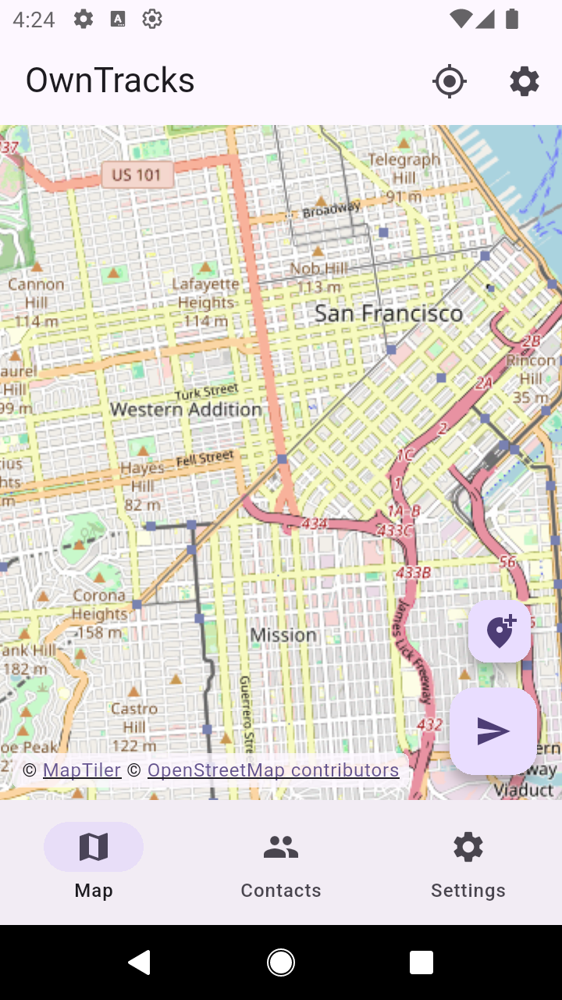
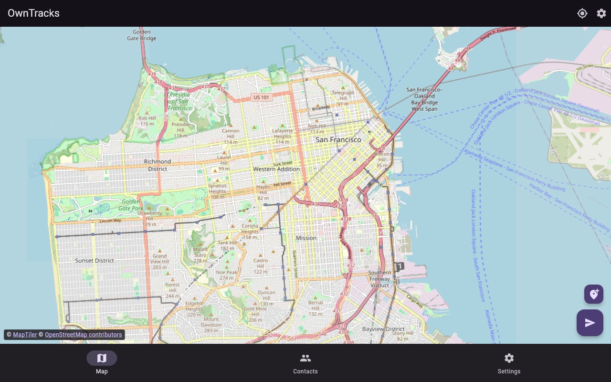

# OwnTracks Flutter

OwnTracks lets you keep track of your own location — and share it only with the
people you choose, on infrastructure you control. Historically that meant two
separate native apps (Kotlin/Java for Android, Objective-C for iOS) evolving in
parallel. This project replaces both with a single Flutter codebase that runs
on **Android, iOS, and the web**: real-time location publishing over MQTT or
HTTP, geofencing with enter/exit events, waypoint management, and end-to-end
XSalsa20-Poly1305 payload encryption — one implementation of the OwnTracks protocol,
three platforms, no vendor cloud in the loop.

## Screenshots

| Android | Web |
|:---:|:---:|
|  |  |

## Quick Start

```bash
git clone <this-repo>
cd owntrack
flutter pub get
flutter build apk        # Android release APK
```

That builds out of the box. To see map tiles you also need a (free) MapTiler
key — see [Map tiles](#map-tiles-required) below. Run it locally with:

```bash
flutter run -d chrome --dart-define=MAPS_API_KEY=$MAPS_API_KEY   # web
flutter run --dart-define=MAPS_API_KEY=$MAPS_API_KEY             # device/emulator
```

## Architecture

This app uses a clean architecture pattern with:

- **State Management**: Riverpod with code generation
- **Navigation**: go_router
- **Storage**: transactional SQLite outbox on native platforms, IndexedDB outbox on web, SharedPreferences for nonsecret settings
- **Maps**: flutter_map with MapTiler/OpenStreetMap tiles
- **Networking**: MQTT (mqtt_client) and HTTP (dio)

## Project Structure

```
lib/
├── core/               # Core utilities and infrastructure
│   ├── constants/      # App-wide constants
│   ├── errors/         # Error classes and failures
│   ├── extensions/     # Dart extensions
│   ├── router/         # Navigation configuration
│   └── utils/          # Utility classes (logger, etc.)
│
├── data/               # Data layer
│   ├── models/         # Data models
│   ├── repositories/   # Repository pattern implementations
│   ├── datasources/    # Local (DB/prefs) and remote data sources
│   └── services/       # Platform services
│
├── domain/             # Business logic layer
│   ├── providers/      # Riverpod providers
│   └── use_cases/      # Business logic use cases
│
├── presentation/       # UI layer
│   ├── screens/        # App screens
│   ├── widgets/        # Reusable widgets
│   └── theme/          # App theme
│
└── platform/           # Platform-specific code
    ├── android/        # Android-specific implementations
    └── ios/            # iOS-specific implementations
```

## Development Commands

### Setup

```bash
# Install dependencies
flutter pub get

# Run code generation
flutter pub run build_runner build --delete-conflicting-outputs
```

### Map tiles (required)

Map tiles come from [MapTiler](https://www.maptiler.com/). The OpenStreetMap
Foundation's public servers (`tile.openstreetmap.org`) are donation-funded and
their [tile usage policy](https://operations.osmfoundation.org/policies/tiles)
forbids distributed applications, so a MapTiler API key is needed.

Get a free key from the MapTiler dashboard and pass it at build time. Flutter
resolves `String.fromEnvironment` at *compile* time, so a shell variable alone
is not enough — it must be forwarded as a `--dart-define`:

```bash
flutter run --dart-define=MAPS_API_KEY=$MAPS_API_KEY
flutter build web --release --dart-define=MAPS_API_KEY=$MAPS_API_KEY
```

Or keep it in a git-ignored `dart_defines.json` (see `dart_defines.example.json`):

```bash
flutter run --dart-define-from-file=dart_defines.json
```

Without a key the map renders an explanatory placeholder rather than a blank
grid. Because a client-side tile key ships inside the bundle, restrict it by
allowed origin in the MapTiler dashboard — it is not a secret once distributed.

### Testing

```bash
# Run all tests
flutter test

# Run tests with coverage
flutter test --coverage

# Run specific test file
flutter test test/core/errors/failures_test.dart
```

### Code Quality

```bash
# Analyze code
flutter analyze

# Format code
dart format lib/ test/
```

### Building

```bash
# Run on connected device/emulator
flutter run

# Build Android APK
flutter build apk

# Build iOS (requires macOS and Xcode)
flutter build ios

# Build for web
flutter build web --release --dart-define=MAPS_API_KEY=$MAPS_API_KEY
```

## Status

The repair loop and current evidence are recorded in the
[quality regrade](docs/quality/2026-09-20/regrade-3.md). Release readiness still
requires physical-device background/GPS and native secure-storage tests,
deployed-broker and Recorder interoperability, and an accessibility review.

- **Delivery**: startup owns MQTT/HTTP reception and retry processing. HTTP uses
  POST response messages; native MQTT uses sockets/TLS and browser MQTT uses WSS.
  Messages remain in the transactional outbox until HTTP success or a broker
  acknowledgement. Retries do not silently discard messages.
- **Storage**: the outbox accepts at most 10,000 records or 20 MiB. Capacity errors
  are surfaced to callers. Legacy preference queues migrate before startup;
  records without an original destination remain blocked for recovery. Changing
  an endpoint or encryption identity never redirects existing queued locations.
  **Settings → Outbox** can export selected stored envelopes, discard confirmed
  records, and retry delivery after the original settings are restored. Exports
  contain private location history; keep them in a trusted destination. There is
  no automatic expiry, rerouting, ciphertext conversion, or export-file import.
- **Secrets**: native credentials use verified secure storage; browser credentials
  live only in session memory, survive startup retries, and must be entered
  again after a page reload. Shareable
  configuration omits endpoints and secrets. When restored settings conflict with
  credentials stored on the device, startup requires choosing each source and
  confirming the selection before migration. Confirmation warns that unselected
  versions will be discarded. Selected writes are verified before removing
  restored plaintext copies; keep any old encryption keys needed to recover
  queued ciphertext.
- **Encryption**: OwnTracks secretbox framing uses a zero-padded UTF-8 key of up
  to 32 bytes, a 24-byte nonce, and XSalsa20-Poly1305 authentication. An independent
  libsodium vector is covered by tests. Legacy ciphertext is retained, not
  silently converted or transmitted under a different key.
- **Tracking**: Quiet and Manual do not open an automatic GPS stream. Explicit
  publication is allowed in both modes. Mode changes reconfigure active tracking.
  Significant and Move use distinct acquisition settings. **Tracking → Publication
  settings** controls the minimum interval, movement threshold, heartbeat and
  optional heading trigger. Defaults are 30 seconds, 50 metres and five minutes,
  with heading disabled. Scheduling uses monotonic time; heartbeat requires fresh
  fixes from the operating system. Native battery readings are currently unavailable
  and omitted, rather than fabricated.
  On iOS, background permission requires an actual Always authorization;
  foreground permission alone is insufficient. A permanently denied upgrade
  offers OS Settings recovery, and permission status refreshes on app resume.
- **Geofencing**: the first confident fix establishes occupancy without an entry
  event. Subsequent crossings apply an accuracy-aware margin of at least 10 metres.
  Failed queue insertion retains each original crossing in memory for retry on
  the next fix, independently for overlapping regions. Once accepted, the event
  lives in the durable outbox; an unaccepted event cannot survive process death.
- **UI**: publication reports durable queue acceptance, and delivery errors/backlog
  are visible. Map, contacts, waypoint/region management and settings remain
  available; missing tile configuration has an explicit empty state.
  Failed settings writes stay visible and retryable. Credential recovery shows
  source labels without displaying secret values and requires a fresh settings
  reload after a failed migration attempt.

Additional integration checks:

```bash
flutter test --platform chrome test/browser/outbox_test.dart test/browser/bootstrap_recovery_test.dart
# Start an isolated loopback MQTT broker first, then use its port:
flutter test --dart-define=MQTT_TEST_PORT=28884 test/integration/mqtt_broker_test.dart
# Create temporary authenticated TLS/WSS brokers, run checks, then clean up:
bash tool/verify_mqtt_tls.sh
bash tool/verify_mqtt_wss.sh
```

The secure transport checks require Mosquitto and its clients, OpenSSL, Python 3,
and Chrome for WSS. They cover real publish/receive, rejected credentials and
certificates, and reconnect. Browser trust is limited to one temporary fixture
leaf certificate in the test profile; system trust is untouched. Native TLS also
checks hostname rejection. These local checks do not verify production broker
deployment or device keychains.

The checked-in CI workflow runs browser storage and isolated plaintext/TLS/WSS
broker tests as blocking steps. Hosted execution must still be verified after
pushing.

The Android release build currently uses the repository's development signing
configuration. It is not a store-ready signed release. The local build reports
SDK/Kotlin compatibility warnings; see the regrade before distribution.

## Dependencies

### Core
- **flutter_riverpod**: State management
- **go_router**: Navigation
- **logger**: Logging framework

### Data
- **drift**: transactional native outbox storage
- **shared_preferences**: Settings storage

### Networking
- **mqtt_client**: MQTT protocol
- **dio**: HTTP client
- **connectivity_plus**: Network status

### Location
- **geolocator**: Location services
- **permission_handler**: Permissions
- **flutter_background_service**: Background tasks

### Maps
- **flutter_map**: Map rendering
- **latlong2**: Latitude/longitude calculations

### Security
- **pinenacl**: OwnTracks-compatible secretbox payload encryption
- **cryptography**: SHA-256 destination identity fingerprints
- **flutter_secure_storage**: Secure key storage

### UI/UX
- **cached_network_image**: Image caching
- **flutter_local_notifications**: Notifications
- **url_launcher**: Deep linking
- **share_plus**: Sharing

### Development
- **build_runner**: Code generation
- **riverpod_generator**: Riverpod code generation
- **mocktail**: Testing mocks
- **flutter_test**: Widget testing

## License

Same license as the original OwnTracks projects.
